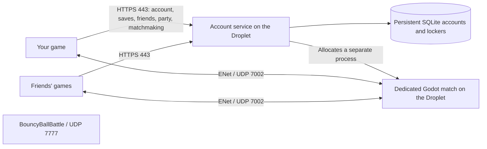

# 1.5.3: visible returns after runs and every out

Install the rebuilt Windows client and `deployment/mlp-dedicated-1.5.3-linux-x86_64.tar.gz` together. The match worker owns return-walk authorization and the new dugout routing. Hosting deployment remains manual using the pinned installer.

Human and bot scorers, strikeout victims, caught batters, tagged/forced runners and stranded runners at an inning change stay visible and walk into their own dugout. Retired runners leave the active baserunning list immediately, so their return cannot score or create another out. Home-run runners finish the bases before cleanup starts the dugout walk. A home-run batter missing its runner record is registered once so its full trip is preserved. Completed at-bats no longer restore the old batting stance or hide the retiring body.

The return route uses the team's side of the field, separate approach lanes, the actual stairs and the dugout interior. Explicit server authorization lets a returning athlete enter only their own dugout during a live play. Waiting players retain the normal closed-gate rules. Waiting NPCs clear the entry lanes, and blocked walkers can sidestep and re-route without teleporting. Roles switch to waiting only once the athlete is inside. The next role assignment waits for current return walks; extra-inning ghost-runner reuse happens afterward.

The simple recessed dugout design, sitting, relaxed NPC behavior, closer hugs, persistent waiting positions, team/role access rules, defensive throw recovery and all prior camera fixes remain included. The stair ceiling now leaves headroom at the entrance. Building detail was already repaired externally and is intentionally unchanged in this update.

# How Online works in 1.4.6

The account service is already live. The dedicated-match build must be installed on the Droplet before the new Online client can find a match. The new client never falls back to running a match on a player's PC.

Your computer reads controls, updates its local movement/camera, and renders the field and characters. It sends movement, swing and interaction updates to the match server. The match server runs bot AI, match rules, ball simulation and scoring, then sends game and animation updates to every player. It has no playable host character. Everyone connects as a client.

The party leader controls invitations and the Find Match button. That is a group-management role, not a game server. If the leader leaves a party, leadership transfers to a remaining member. Their match continues on the Droplet, and the existing match logic replaces departed players with bots.

Matchmaking searches for up to one minute, keeps party members on the same team, and fills the other positions with bots. Once complete groups connect, players pick positions; after 30 seconds, unpicked positions are assigned and the server starts the game. One-use account tickets and account-bound server receipts verify both sides of the connection.

Bats, helmets, equipped items, Club Cash and quest progress are stored in `/var/lib/mlp-social/social.sqlite`. Accounts and accepted friendships survive restarts. Unsynchronized offline rewards remain queued on the device until it reconnects; career seasons and control/video settings remain local.

The shared 1 GB Droplet starts with **one concurrent baseball match**, supporting up to 14 humans. Further groups wait for that slot. The Godot process uses a headless renderer, no audio, and a 30 Hz server physics tick. The account service and its game worker share a 512 MiB hard memory limit and a 70% CPU ceiling, with low scheduling priority. These limits protect the other game from unbounded baseball load; the Droplet still needs a real load check after deployment.

The account HTTPS proxy remains on TCP 80/443. Baseball matches use **UDP 7002**. BouncyBallBattle keeps **UDP 7777**. Players do not need to forward ports on their home routers. If the Droplet has a DigitalOcean cloud firewall, add an inbound UDP 7002 rule there; an active UFW firewall is handled by the installer.

## Install on the existing Droplet

Version 1.4.6 creates a continuous static city-floor collider on the headless match worker as well as graphical clients. Its top is at 7.9, below the authored field turf, and covers the city and distant home-run landing areas. The graphical client uses a matching thick ground slab with continuous roads/paving instead of a one-sided visual plane. The city-floor update requires both the worker pack and Windows client; accounts, ports and resource limits are unchanged.

Version 1.4.6 changes bot fielding throws on the match worker: bots plant, turn at a bounded angular speed, transfer the ball out of the mitt, wind up for 0.42 seconds and release at the actual free hand, then follow through for 0.28 seconds. The queued receiver is validated again before release; invalid receivers or interrupted athletes cancel safely. The existing full-pose stream includes the throw, and a reliable release-pose sample preserves the release frame on observers. Deploy both the server pack and Windows client; the account database, ports and resource limits are unchanged.

Use `server/install-dedicated-digitalocean.sh` from the published, pinned backend commit. It downloads the pinned archive, verifies SHA-256, runs backend tests, loads the actual headless field in a self-test, backs up SQLite, and adds the dedicated-game environment through a systemd drop-in. It restarts only `mlp-social`. It leaves HTTPS and the other game's service running. Failed health checks restore the previous baseball code/configuration and keep account data.

Success prints `DEDICATED BASEBALL SERVER READY`. The live `/health` response must then contain `"dedicated_matches":true` and `"game_version":"1.4.6"`. A match worker opens UDP 7002 when a match is allocated; that port is normally idle between matches.

Use the rebuilt `MajorLeaguePhysics.exe` on every player's computer. Old 1.2 clients cannot join 1.4.6 dedicated matches.

Version 1.4.6 streams the actual full-body poses and equipment of human players as well as bots. Human poses travel on a separate small unreliable-ordered channel and are relayed by the dedicated server. Observers interpolate the recorded joints and skin instead of running another spring/IK simulation for a player holding the ball. Interaction event numbers reject poses sent before a punch or throw.

The runtime retains the mound collision and mitt calibration even when graphics are stripped. Remote human equipment has one network owner; observer IK reads its final pose instead of repeatedly rotating or fitting it.

Player colliders, gloves and rigs retain their stable peer-based names and ordered interaction effects from 1.3.3. Fielding and running speed is 25% higher than that build, with stronger acceleration and braking. The bottom punch/grab hint is removed.

Each graphical client keeps a bounded 20-second recording of real athlete poses and baseball transforms at 30 Hz. Replays retain the continuous play, beginning before the swing, and use recorded timestamps instead of squeezing every clip into a fixed duration. Foul balls cancel the pending replay. Near force outs, tags and contested safe arrivals mark a close call: only the recorded finish slows to 35% speed, with a tighter view of the players. The server computes a shared replay window from the play length and close-call finish, up to 26 seconds. Playback never changes live physics, scores, inventory or transforms. Cameras, HUD and fresh inputs return afterward. The worker stays headless and keeps the same resource limits.

Version 1.4.6 also predicts the hitter's initial ball response immediately while retaining server validation, and broadcasts confirmed contact promptly. Ball rendering uses velocity prediction with small correction smoothing instead of permanently trailing a moving target. Bot snapshots run after the current tick's batting update at 30 Hz; an ordered contact-pose message puts the actual bat and hands on the ball before the hit appears. Older pre-contact ball/pose packets cannot undo that contact. No DNS, firewall, ports or database changes are required: update the game pack/backend together and use the matching Windows client. Baseball remains on UDP 7002 and the other game on UDP 7777.

Version 1.4.6 adds steal replays from the runner's break through the safe or caught-stealing call. The camera follows the runner, with the existing slow-motion finish for close tags and contested arrivals. Plain fouls still cancel the replay.

While fielding with an empty throwing hand, aim at a nearby teammate and tap left click to punch, hold to grab, and release to throw. The same tap/hold/release behavior uses the remappable controller grab button. Existing hand-sweep punches remain supported. A release that happens before the grab acknowledgement is buffered with its original aim. Server validation checks nearby bodies and world occlusion instead of a delayed animated hand position. Grabs use the existing collision-based rigid-body proxy with a force applied at a shared chest grip: gravity, inertia, ground impacts and off-center torque affect the body. The grabber's right hand solves IK onto that actual point and carrying reduces movement speed with a reaction load. Aim updates are validated and relayed to the other clients; full-body pose replication carries the resulting appearance. The carried human's physics runs on that player's existing movement authority, while the server validates interaction events and runs bot physics. Spectators, opponents and players beyond reach are not interaction targets; holding a baseball keeps the normal baseball throw controls. Deploy the 1.4.6 pack/backend and matching client together; ports and account storage are unchanged.

Version 1.4.6 makes defense react as soon as a runner breaks, including before a pitch reaches the plate. Bots cover the destination bag, hold it while receiving a throw, back up absent human fielders and prioritize live steal threats over unrelated ball calls. Deep leads trigger urgent pickoff attempts; safe runners remain protected. Throws keep the turn, transfer and windup animation, and outs still require real tags. Dead-pitch cleanup no longer awards a free base for being halfway there. These shared rules apply to offline baseball and the dedicated worker. Deploy the updated pack/backend and matching Windows client; account storage and ports are unchanged.

Version 1.4.6 smooths remote movement every rendered frame with bounded velocity prediction (at most 100 ms), increases human state/pose sampling to 30 Hz, and sends independent bot poses on an unordered channel with per-athlete stale-frame rejection. Human poses keep revision rejection; ball snapshots use their own ordered channel. The worker compresses each bot once rather than repeatedly compressing oversized batches, sends unchanged HUD values at 5 Hz, and skips graphics-only skeleton uploads while retaining real animation joints, glove positions and authoritative catches/tags. Fly assistance gently steps an idle grounded fielder toward a nearby descending fly during its final 1.1 seconds; input, possession, dives and forced walks cancel it. Low balls have a wider reachable mitt tolerance. Both client and server must be updated. The 30 Hz simulation, account storage, resource limits, and other game's UDP 7777 service are unchanged. These changes remove added rendering/network overhead; they cannot eliminate internet latency or guarantee a particular frame rate.
