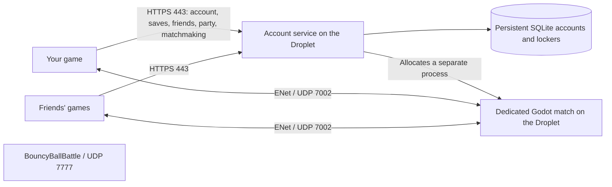

# How Online works in 1.3

The account service is already live. The dedicated-match build must be installed on the Droplet before the new Online client can find a match. The new client never falls back to running a match on a player's PC.

Your computer reads controls, updates its local movement/camera, and renders the field and characters. It sends movement, swing and interaction updates to the match server. The match server runs bot AI, match rules, ball simulation and scoring, then sends game and animation updates to every player. It has no playable host character. Everyone connects as a client.

The party leader controls invitations and the Find Match button. That is a group-management role, not a game server. If the leader leaves a party, leadership transfers to a remaining member. Their match continues on the Droplet, and the existing match logic replaces departed players with bots.

Matchmaking searches for up to one minute, keeps party members on the same team, and fills the other positions with bots. Once complete groups connect, players pick positions; after 30 seconds, unpicked positions are assigned and the server starts the game. One-use account tickets and account-bound server receipts verify both sides of the connection.

Bats, helmets, equipped items, Club Cash and quest progress are stored in `/var/lib/mlp-social/social.sqlite`. Accounts and accepted friendships survive restarts. Unsynchronized offline rewards remain queued on the device until it reconnects; career seasons and control/video settings remain local.

The shared 1 GB Droplet starts with **one concurrent baseball match**, supporting up to 14 humans. Further groups wait for that slot. The Godot process uses a headless renderer, no audio, and a 30 Hz server physics tick. The account service and its game worker share a 512 MiB hard memory limit and a 70% CPU ceiling, with low scheduling priority. These limits protect the other game from unbounded baseball load; the Droplet still needs a real load check after deployment.

The account HTTPS proxy remains on TCP 80/443. Baseball matches use **UDP 7002**. BouncyBallBattle keeps **UDP 7777**. Players do not need to forward ports on their home routers. If the Droplet has a DigitalOcean cloud firewall, add an inbound UDP 7002 rule there; an active UFW firewall is handled by the installer.

## Install on the existing Droplet

Use `server/install-dedicated-digitalocean.sh` from the published, pinned backend commit. It downloads the pinned archive, verifies SHA-256, runs backend tests, loads the actual headless field in a self-test, backs up SQLite, and adds the dedicated-game environment through a systemd drop-in. It restarts only `mlp-social`. It leaves HTTPS and the other game's service running. Failed health checks restore the previous baseball code/configuration and keep account data.

Success prints `DEDICATED BASEBALL SERVER READY`. The live `/health` response must then contain `"dedicated_matches":true` and `"game_version":"1.3.0"`. A match worker opens UDP 7002 when a match is allocated; that port is normally idle between matches.

Use the rebuilt `MajorLeaguePhysics.exe` on every player's computer. Old 1.2 clients cannot join 1.3 dedicated matches.
